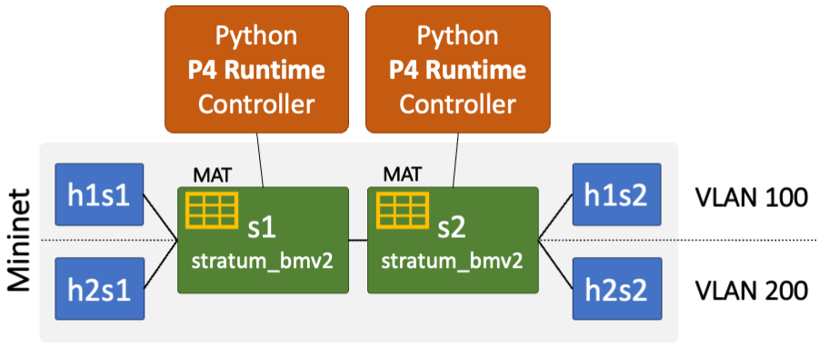
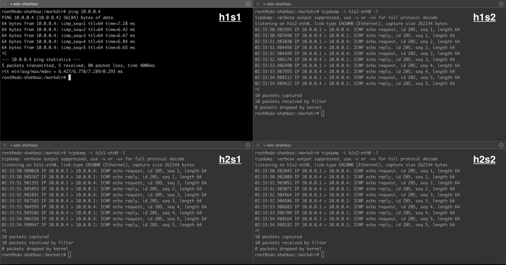
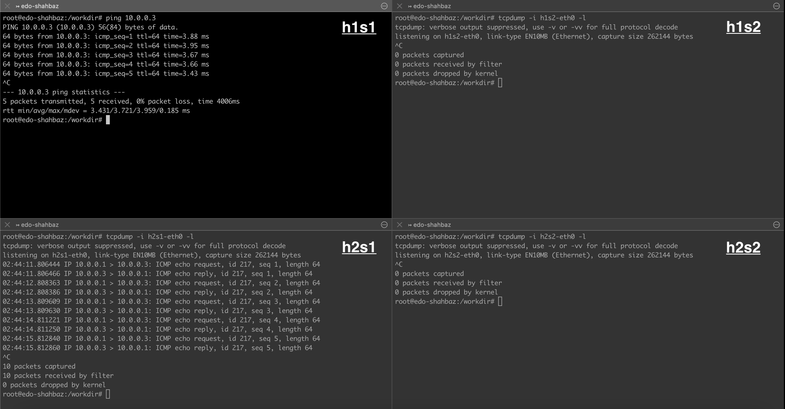

# Assignment 4: From Bridging to Switching using P4's Match-Action Tables (MATs)

In this assignment, we will look at how programmable network devices can help accelerate networking by executing parts of the communication logic directly in the data-plane hardware using match-action tables (MATs). We will extend [assignment2](../assignment2) and create a custom switch (using P4) that would forward packets in the data plane and use the control plane for learning (match-action) flow rules only. 

You will build and run your switch on an emulated Mininet network using P4 programmable switches and the P4 Runtime API.

> **NOTE:** You may work in a team of **TWO** if you would like (this is strongly suggested but not required; grading will only be based on your submission regardless of the size of the team).

## Getting Started

### Part A: Virtual environment and network topology

This assignment builds on [assignment0](../assignment0), so please ensure that you have a successfully working virtual environment. *Although it follows from the previous assignment, you'll have to rerun the instructions from the current `assignment4` folder.* You will be building a slightly different network, as depicted in the following figure. It's similar to the one in [assignment2](../assignment2), but with match-action tables residing in the switches now.

<br>

- The example network consists of two switches (`s1` and `s2`) with four hosts (`h1s1`, `h2s1`, `h1s2`, and `h2s2`). You may consider it as a network with two segments: `h1s1` and `h2s1` forming one segment with `s1`, and `h1s2` and `h2s2` forming the other one with `s2`. Moreover, when VLAN is enabled, `h1s1` and `h1s2` form one virtual LAN (`100`) and `h2s1` and `h2s2` form another virtual LAN (`200`). **Note: your assignment will be graded against different topologies and not just the one shown here!**

- We will be using the [P4 language](https://p4.org/) to program the two network switches to implement the necessary logic (bridging or switching) for forwarding packets (e.g., drop or forward or broadcast). Moreover, unlike in [assignment2](../assignment2), this time packets will be matched and acted upon directly within the switch using the match-action tables (MATs), with flow rules configured by the control plane (read next).

  > **INFO:** The Programming Protocol-independent Packet Processors (P4) is an open-source, domain-specific language for modern network devices (programmable switches, SmartNICs, FPGAs, and more). Since its inception in 2014, it has already gained wide traction and adoption from industry and academia alike (see more [here](https://p4.org/)).

- Instead of ONOS, we will be using the [P4 Runtime API](https://p4.org/wp-content/uploads/sites/53/2024/10/P4Runtime-Spec-v1.4.1.html) to write a custom Python-based controller to learn and update MAT rules in the network switches.
  > **INFO:** The P4 Runtime API is the same southbound API used by the ONOS controller when interacting with the P4 programmable switches (see more [here](https://www.youtube.com/watch?v=BE_y-Sz0WnQ)).

- We have also updated [`Makefile`](Makefile) to make it easier to run and test your assignment. You can type `make help` from the top directory to list an example usage of the necessary commands.

### Part B: A walkthrough of a learning bridge

Before implementing a learning switch in P4, let's take a walkthrough of the provided codebase using the learning bridge as an example. 

Recall that a simple bridge broadcasts each incoming packet to all ports, except the ingress port. A learning bridge optimizes this simple bridge by dropping all packets that belong to the same segment. For example, in the topology earlier, if `h1s1` is communicating with `h2s1`, the switch `s2` will drop any such packets arriving on its port connected to `s1`. It will do so by maintaining a table that maps the source Ethernet address to the ingress port for each packet it sees. Then, for later packets, the switch looks up the table using their destination Ethernet address: if the port found is the same as the ingress port of the incoming packets, indicating that the destination resides on the same port the packets came in from, the switch drops such packets; otherwise, it broadcasts them as usual.

#### The learning bridge code

Previously, in [assignment2](../assignment2), the [`bridge.py`](../assignment2/p4rt-src/bridge.py) script was implementing the entire logic of a learning bridge, including the table for filtering same-segment packets. Whereas the [`bridge.p4`](../assignment2/p4-src/bridge.p4) code was simply forwarding all incoming traffic from hosts to the Python runtime and traffic from the runtime to the hosts---it wasn't bridging the packets, itself.

This time, however, if you look at the [`bridge.p4`](p4-src/bridge.p4) code under the `p4-src` folder, it implements a table [`bridge_table`](p4-src/bridge.p4#L102) that matches the destination Ethernet address and ingress port of the arriving packet. A successful match indicates that the destination host resides on the same port as the source host, and the bridge should therefore drop the packet. To do so, when broadcasting packets to egress ports, the bridge sends a copy of the packet to the Python runtime (or controller), [`bridge.py`](p4rt-src/bridge.py). The controller learns the source Ethernet address and ingress port of the packet and installs a rule in `bridge_table` with a `drop` action. Next time, whenever the destination address and ingress port of a packet match the table entry, it's dropped by the bridge.

> **NOTE:** Pay close attention to which Ethernet address is being used for learning and forwarding. When learning, the controller installs a flow rule with the packet's source Ethernet address [`line 105`](p4rt-src/bridge.py#L105). However, when forwarding, the bridge uses the packet's destination Ethernet address for lookup [`line 104`](p4-src/bridge.p4#L104).

Please invest some time going through the [`bridge.p4`](p4-src/bridge.p4) and [`bridge.py`](p4rt-src/bridge.py) code to understand their various components in detail. You will be working with similar functions when implementing your custom learning switch.

- **Bridging in P4** <br>The P4 code has the following main components:
  - **Header declarations, [`line 38`](p4-src/bridge.p4#L38).** Defines the Ethernet and PacketIn header structures used by the bridge.
  - **Packet parsing, [`line 63`](p4-src/bridge.p4#L63).** Parses the Ethernet header of each incoming packet and forwards it to the ingress-processing stage. The ingress port is provided as part of the `standard_metadata` structure, which is pre-populated by the underlying data plane.
  - **Ingress processing, [`line 90`](p4-src/bridge.p4#L90).** Implements `bridge_table` to match the destination Ethernet address and ingress port for filtering same-segment packets, as well as broadcast non-matching packets to all egress ports (including the controller port).
  - **Egress processing, [`line 124`](p4-src/bridge.p4#L124).** Prunes broadcast packets going to the same ingress port, as well as sets the `packet_in` header to valid for packets going to the controller.
    > **INFO:** The egress-processing stage receives a separate copy for each of the ports the packet is being broadcast to. For example, if a bridge has four ports, the egress-processing stage will receive four copies of the packet from the ingress stage when the broadcast/flood action is used.
  - **Packet deparsing, [`line 159`](p4-src/bridge.p4#L159).** Seralizes packets' headers and body for departure. 
- **Learning in Python controller** <br>The [`ProcPacketIn()`](p4rt-src/bridge.py#L74) function in `bridge.py` receives and processes all packets entering the controller. Compared to [assignment2](../assignment2), its logic is simple this time; it reads the source Ethernet address and ingress port from the packet and installs a rule in `bridge_table` on the data plane **[`line 104`](p4rt-src/bridge.py#L104)**.

To see all this in action, please give it a try yourself!

<details><summary><b>Try it yourself! (Click Me)</b></summary>
<br>

- **Start the Mininet environment**. On a new terminal, run:
  ```bash
  $ cd assignments/assignment4
  $ sudo make mininet topo=linear,2,2
  ```

  > **INFO:** The argument `topo=linear,2,2` tells Mininet to start the virtual environment with our example topology, above (i.e., two switches connected linearly with each having two hosts). You can verify this by running the `nodes` command from within the Mininet shell.
  > 
  > ```bash
  > mininet> nodes
  > available nodes are:
  > h1s1 h1s2 h2s1 h2s2 s1 s2
  > ```

  Notice that Mininet now runs two switches, each listening on its respective GRPC port for the Python controller to connect to.
  ``` bash
  *** Starting 2 switches
  s1 ⚡️ stratum_bmv2 @ 50001
  s2 ⚡️ stratum_bmv2 @ 50002
  ```

- **Start learning bridge (Python controller) for each switch**.
  - Open a new terminal and connect to `s1` on port 50001
    ```bash
    $ sudo make controller name=bridge grpc_port=50001 topo=linear,2,2
    ```
  - Open another terminal and connect to `s2` on port 50002 
    ```bash
    $ sudo make controller name=bridge grpc_port=50002 topo=linear,2,2
    ```

  > **INFO**: The argument `name=bridge` specifies whether you are running a bridge or a switch, `grpc_port=50001` tells which grpc port to connect to, and `topo=linear,2,2` indicates the topology being used.

  Once running, you should see INFO messages start to print on the terminal. For example, here's a sample output for `s1`:
  ```bash
  Bridge Started @ Port: 50001
  Press CTRL+C to stop ...
  INFO: Log committed to logs/bridge-50001-table.json
  INFO: Log committed to logs/bridge-50001-table.json
  ```

  > **INFO:** 
  > - You can view current entries in the learning bridge table using, e.g., `sudo make controller-logs name=bridge grpc_port=50001`.
  > - You can terminate the controller by pressing CTRL+C at any time.

- **Start `tcpdump` on `h2s1`, `h1s2`, and `h2s2`**.
  - In a new terminal, log into `h2s1` using `sudo make host name=h2s1` and run:
    ```bash
    root# tcpdump -i h2s1-eth0 -l
    ```
  - Repeat the same step for the remaining two hosts `h1s2` and `h2s2`.

- **Let's ping `h2s2` from `h1s1` sitting across the two switches**.
  - In a new terminal, log into `h1s1` using `sudo make host name=h1s1` and run:
    ```bash
    root# ping 10.0.0.4
    PING 10.0.0.4 (10.0.0.4) 56(84) bytes of data.
    64 bytes from 10.0.0.4: icmp_seq=1 ttl=64 time=11.3 ms
    64 bytes from 10.0.0.4: icmp_seq=2 ttl=64 time=5.43 ms
    ```
    > **INFO:** You can find the IP address of the host using the `ip address` or `hostname -I` commands. For example, from inside `h2s2`, run:
    > ```bash
    > # hostname -I
    > 10.0.0.4
    > ```
  - From the `tcpdump` output for `h2s1`, `h1s2`, and `h2s2`, you will see that all these hosts are receiving the ICMP echo request/reply packets, which is the right behavior as hosts (`h1s1` and `h2s2`) are sitting across switches in two different segments. Here's a sample output with all terminals displayed together.<br><br>
  <br>

- **Let's ping `h2s1` from `h1s1` sitting on the same switch**.
  - From `h1s1` terminal run:
    ```bash
    root# ping 10.0.0.3
    PING 10.0.0.3 (10.0.0.3) 56(84) bytes of data.
    64 bytes from 10.0.0.3: icmp_seq=1 ttl=64 time=3.88 ms
    64 bytes from 10.0.0.3: icmp_seq=2 ttl=64 time=3.95 ms
    ```
  - This time, from the `tcpdump` output for `h2s1`, `h1s2`, and `h2s2`, you will see that only `h2s1` is receiving the ICMP echo request/reply packets. The learning bridge is successfully filtering packets destined to hosts in the same segment. Here's a sample output with all terminals displayed together.<br><br>
  <br>
</details>

